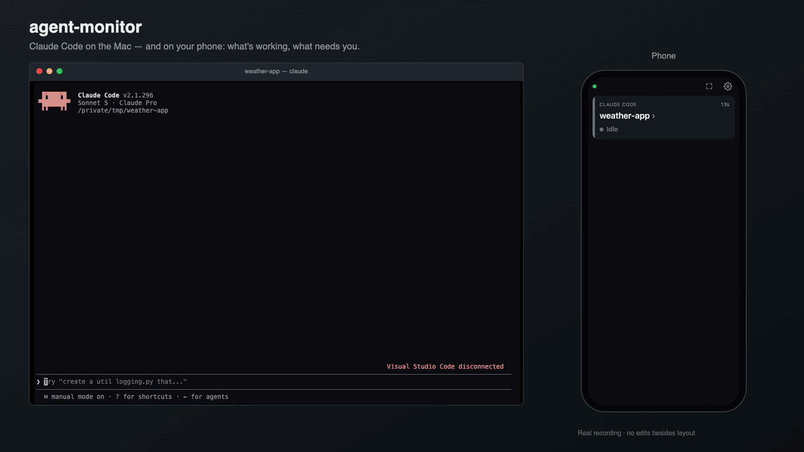

# agent-monitor

A tiny second screen for your coding agents. A menu-bar app on your Mac runs a small local server. An old phone, or any browser on your Wi-Fi, then shows which agents are **working** and which are **waiting for you**. It is local-only and nothing leaves your network. Password-protected and served over HTTPS. Supports **Claude Code** and **Codex**.

- **[First Time Install](setup.md#first-time-install)**: install, choose a password, connect your agents and your phone.
- **[Updating](setup.md#updating)**: get a new version while keeping your settings, password and hooks.

[](docs/demo.mp4)

<sub>A real, unedited recording (41 s): Claude Code asks for permission, so the phone card turns red; once approved and finished, it turns green ("your turn"), and the phone opens the live transcript. [Watch the MP4](docs/demo.mp4).</sub>

```
Claude Code ─┐ hook (curl, 1s cap, never blocks)
Codex        ─┴─► POST 127.0.0.1:47821/api/events ─► server ─► HTTPS + SSE (password login) ─► phone browser
                                                        └── tray app (Electron): sessions, phones, password, hooks
```

## Commands

| Command | What it does |
|---|---|
| `pnpm host` | Build and start the menu-bar app, detached from the terminal. Output goes to `~/.agent-monitor/host.log`. Running it again opens the window of the instance that's already running. Add `--foreground` to keep it attached (for development). |
| `pnpm hooks` | Show whether agent-monitor's hooks are in each agent's config. |
| `pnpm hooks install [claude\|codex]` | Add the hooks (to both agents if you don't name one). |
| `pnpm hooks uninstall [claude\|codex]` | Remove the hooks, and only agent-monitor's. |
| `pnpm stop` | Quit agent-monitor (same as **Quit** in the menu). |
| `pnpm package` | Build a standalone `.app` (see below). |

The menu-bar dot shows the overall state: red = needs approval, green = your turn, amber = working, grey = idle. The number shows how many sessions need you.

## Hooks

agent-monitor **never edits your agents' config on its own**: not at launch, and not when you tick or untick an agent. You add or remove its hooks with `pnpm hooks install` / `pnpm hooks uninstall`, or with the **Install hooks** / **Uninstall** buttons in the window.

- **Files:** `~/.claude/settings.json` (Claude Code) and `~/.codex/hooks.json` (Codex).
- **What's added:** one entry per event (`SessionStart`, `UserPromptSubmit`, `PreToolUse`, `PostToolUse`, `PermissionRequest`, `Stop`, `SessionEnd`, plus `Notification` for Claude). Each entry runs this command (`pnpm hooks install` prints it too):

  ```
  AGENT_MONITOR=1 curl -s -m 1 -X POST -H 'content-type: application/json' --data-binary @- 'http://127.0.0.1:47821/api/events?agent=claude' >/dev/null 2>&1 || true
  ```

  It gives up after 1 second, discards its output and always succeeds, so a stopped agent-monitor never slows or breaks the agent.
- **Your hooks are kept.** Before the first change, a one-time `*.agent-monitor.bak` copy of the file is made. Uninstall removes only the entries tagged `AGENT_MONITOR=1`. If a file isn't valid JSON, it is reported and left untouched.
- The agent checkboxes in the window only decide whether that agent's sessions are shown.

Settings (port, password hash, shown agents, TLS) are stored in `~/.agent-monitor/config.json` (mode 0600).

## Security

The phone page is reachable by anything on your Wi-Fi, so it's locked down:

- **Password login.** You must choose a password on first launch; until then every phone login is refused. The strength rules are checked in the window only (the server just requires 6+ characters). The password itself is never written anywhere. `config.json` holds only an scrypt hash (N=32768, r=8, p=1, random 16-byte salt), stored as `scrypt$N$r$p$salt$hash`. A correct login sets an `HttpOnly`, `SameSite=Strict`, `Secure` cookie that lasts 30 days. The cookie is HMAC-signed with a random server secret plus the current hash, so changing the password signs every phone out. Forgot it? Quit agent-monitor, delete the `passwordHash` line from `config.json`, and start it again: the setup screen asks for a new one.
- **Brute-force limit.** After 5 wrong passwords from one IP, that IP is locked out for 15 minutes. Each failure is also slowed down.
- **HTTPS** on the same port. A self-signed certificate (P-256, valid for the Mac's LAN IPs, `localhost` and `<name>.local`) is created in `~/.agent-monitor/tls/`. It is re-issued automatically if the Mac's IP changes, which means the phone warns once more. Plain-http requests from the LAN are redirected to https. Hooks keep posting plain http to `127.0.0.1`, so existing hook configs keep working.
- **Hardening.** Strict Content-Security-Policy, `X-Frame-Options: DENY`, `nosniff`, `no-referrer`, and `no-store` on API responses. Requests whose `Host` isn't an IP, `localhost` or this Mac's name are refused, which blocks DNS rebinding. Hook and notify endpoints accept loopback callers only, and refuse anything that carries a browser `Origin`.
- Requests from the Mac itself (hooks, the tray window, `curl localhost`) need no login.
- The QR code holds only the address. The password never travels in a URL.

**No warning on the phone (optional).** Use a locally trusted certificate, e.g. from [mkcert](https://github.com/FiloSottile/mkcert):

```bash
brew install mkcert && mkcert -install
mkcert -cert-file ~/.agent-monitor/tls/mine.pem -key-file ~/.agent-monitor/tls/mine-key.pem <mac-ip> <mac-name>.local localhost
```

Then add `"tls": { "enabled": true, "cert": "/Users/you/.agent-monitor/tls/mine.pem", "key": "/Users/you/.agent-monitor/tls/mine-key.pem" }` to `config.json`, and install mkcert's root CA (`mkcert -CAROOT` shows where it is) on the phone. To turn HTTPS off completely, set `"tls": { "enabled": false }`.

## Build the .app

```bash
pnpm package      # → apps/host/release/agent-monitor-darwin-arm64/agent-monitor.app
```

Generates the icon, bundles the host, packages it with `@electron/packager`, and ad-hoc signs it (fine on the Mac that built it; giving it to others needs a real Developer ID). Copy it to `/Applications` to use it. It runs tray-only (`LSUIElement`), and **Launch at login** in its window works for the packaged app only.

`pnpm host` and the `.app` use the same port, so run `pnpm stop` when switching between them. Use the `.app` if agent-monitor should come back after a reboot; `pnpm host` does not.

## Icons

Tray: an outlined phone (the second screen) with a status badge — grey idle, amber working, green your turn, red needs approval — plus a count of sessions waiting on you. The glyph is drawn white or near-black to follow the system appearance and re-drawn when it changes; a stopped server shows the phone dimmed with no badge. The app icon is the same phone on a dark tile. Both are generated in code (`apps/host/src/icons.ts`, `apps/host/scripts/make-icon.mjs`) — no image assets to maintain; `pnpm package` regenerates the app icon.

## If you can't see the menu-bar icon

macOS parks a menu-bar item off-screen when the bar is full (the notch takes the middle of it) or when the app is switched off under **System Settings → Menu Bar → Allow in the Menu Bar**. The app detects this, shows a **Dock icon** and opens its window with a note; the tray icon returns by itself once there is room.

## Stop everything

```bash
pnpm stop              # SIGTERM, then SIGKILL after 3s: the tray app (pnpm host or the .app) and its helpers
pnpm stop --dry-run    # list what it would stop
```

Two independent routes find agent-monitor's processes, so a renamed `.app` or a different launcher can't hide one: by executable path, and by port (whatever listens there *and* answers `/api/state` like agent-monitor). If something else holds the port it is reported, never killed. `--port N` checks a custom port. If it still finds nothing but the port is busy, see the holder with `lsof -nP -iTCP:47821 -sTCP:LISTEN`.

## Session names

Each card is titled with the name the harness itself shows, with the project folder as the small label above it. Looked up on every hook event, so renames follow:

| Agent | Source (first match wins) |
|---|---|
| Claude Code | desktop app title (`~/Library/Application Support/Claude/claude-code-sessions`, macOS) → the transcript's own `customTitle` (`/rename`, `--name`), then `aiTitle` — exactly what the CLI puts in the terminal tab → the name in `~/.claude/sessions/*.json`, last |
| Codex | `thread_name` in `~/.codex/session_index.jsonl` |

Auto-generated names like `jonyfridja-81` are ignored, and the folder name is the fallback. The session-file name ranks last on purpose: a CLI started from a desktop-app terminal inherits the *host* session's name there, while its terminal tab shows its own title.

## Unread

When a session raises an alert you'd actually receive (needs approval, or finished — your turn), its card moves into an **Unread** section at the top with a colored ring and a **New** badge; everything else sits under **Other sessions**. With nothing unread the list is plain, with no headings. A card is read when you tap or open it, or when the agent moves on by itself (say you approved it on the Mac); **Mark all read** clears the section. Muted levels or Alerts-off (⚙) don't create unread. State is kept per phone in `localStorage`.

Session alerts don't pop a toast — the highlighted card is the notification (plus flash, sound and vibration if enabled). Custom notifications from `/api/notify` have no card, so they still show a toast.

## Phone settings (⚙)

Theme (System / Dark / Light), **Keep screen on** (Screen Wake Lock where the browser allows it; otherwise a tiny hidden looping video does the job, and Android needs one tap to start it), master **Alerts** switch, which events alert (needs approval / your turn / custom), and how (sound / vibration / screen flash), plus a test button. Saved in the phone's `localStorage`, so each device keeps its own.

## Live transcript

Tap a session on the phone to open a terminal-style live view of its conversation: your prompts, replies, tool calls and their (collapsed) output, following the latest activity. Tap a result to expand it; use back to return.

- Works for CLI **and** desktop-app sessions (both hand hooks a `transcript_path`); it is a transcript view, not a mirror of a terminal.
- The phone only names a session. The file path comes from the agent's own hook, must be a `.jsonl` inside `~/.claude` or `~/.codex` (symlinks resolved), and is never sent to the phone.
- It exposes prompts, code and command output to anyone who can open the phone page, so the host window has a **"Let the phone open a session's live transcript"** switch (default on).
- Already-running sessions get a transcript link on their next event.

## Custom notifications

```bash
curl -X POST http://localhost:47821/api/notify -H 'content-type: application/json' \
  -d '{"title":"Deploy done","body":"prod is green","level":"attention"}'   # info | attention | urgent
```

## Develop

```bash
pnpm test             # reducer, hooks (incl. running the real hook command), adapters, server contract, auth + HTTPS, phone client logic, CLI helpers, host lifecycle
pnpm test:coverage    # same + a coverage floor (the release gate)
pnpm typecheck
```

| Path | What |
|---|---|
| `packages/protocol` | shared types |
| `packages/server` | HTTP(S) + SSE server, pure `reduce()` state machine, config, auth (`auth.ts`), certificates (`tls.ts`) |
| `packages/adapters` | per-agent hook install/uninstall + payload → event mapping |
| `packages/web/public` | phone UI (no build step) |
| `apps/host` | Electron tray app; `controller.ts` holds all logic, `main.ts` is thin UI glue, `scripts/launch.mjs` is `pnpm host` |
| `scripts` | `pnpm hooks`, `pnpm stop`, the test runner |

## Known limits

- Phone alerts are in-page (the page must be visible). System notifications would need a service worker, and browsers only allow those with a *trusted* certificate (see mkcert above), not a self-signed one you clicked through.
- The phone screen can still sleep on some browsers: enable Android "Stay awake while charging".
- `pnpm host` doesn't survive a reboot or logout. For that, use the packaged `.app` with **Launch at login**.
- Esc-interrupting an agent may not fire a hook; such sessions show as idle after 10 minutes.
- The `.app` is ad-hoc signed and macOS-arm64 only for now (`process.arch` decides).
